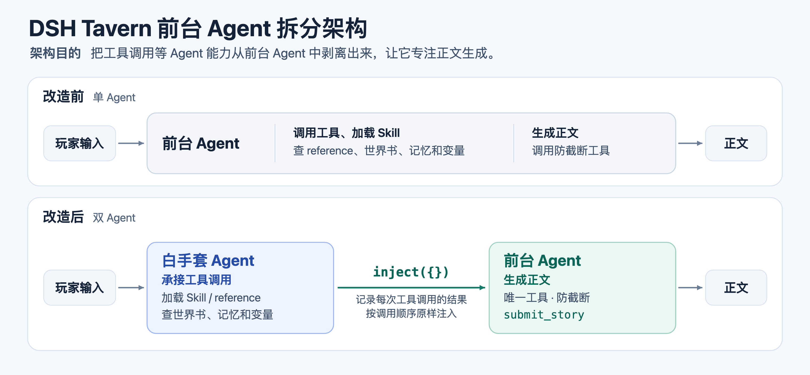

# dsh-tavern-white-glove

白手套是独立安装的 DSH Tavern 插件。它把查询和工具调用交给白手套 Agent，让前台 Agent 专注生成正文，只保留防截断用的 `submit_story`。

## 架构



图中的 `inject({})` 表示资料交接。白手套结束后，酒馆交接世界书、记忆和本轮所需的剧情事实。Skill 和参考文件留在白手套侧。

每局复用一个白手套 Agent。每轮先组装两边共享的人物设定、常驻世界书、写作要求、故事原文、历史注入和本轮玩家输入，白手套在共享内容之后接收本轮世界书标题提示、查询任务和 Skill 目录。宿主压缩过的历史也会随请求保留，包括压缩记录里保留的正文原文。白手套结束后，酒馆将命中的世界书、记忆和白手套提交的简短剧情事实附在前台请求末尾。已在上下文里的同一世界书原文可以直接沿用，条目文本变化时会交接新版。标题提示和查询回执可在白手套的轨迹中查看，模型实际读到的正文可在对应 Agent 的「完整上下文」中查看。

## 安装与更新

**需要支持白手套接口 v6 的 DSH Tavern。** CLI 用户可更新到包含 [白手套宿主支持](https://github.com/flizzywine/dsh-tavern/commit/d417c10458221a080358e107876c265dee2836ad) 的 `main` 构建。

1. 打开酒馆「设置 → DSH Tavern → 插件」，粘贴本仓库地址 `https://github.com/flizzywine/dsh-tavern-white-glove`，点「安装」。
2. 也可以下载 [v0.2.22 安装 ZIP](https://github.com/flizzywine/dsh-tavern-white-glove/releases/download/v0.2.22/dsh-tavern-white-glove.zip)，在同一处点「上传 ZIP」。
3. 按面板提示刷新页面或重启 DSH，确认 `dsh-tavern-white-glove` 显示为已加载。

从 GitHub 地址安装后，可在插件面板检查更新。此前手动安装的用户也可以粘贴新仓库地址原位更新。插件沿用原 ID，已有对局设置与记录会保留。更新已加载的插件后需要重启 DSH。

## 使用

从右侧栏「插件 → 白手套」配置当前对局。已安装的插件默认接管写作流程，白手套的模型默认跟随前台，也可以选择独立模型。白手套在正文生成前运行，模型调用按所用提供商计费。关闭本局接管后，下一轮恢复原有生成流程。

接口 v7 中，白手套根据变量查询结果用一至四句自然语言交接本轮正文需要的状态，保留实际数值和单位，省略字段路径和程序标识。有资料交接时，程序将内容保存在当轮玩家输入与正文之间，后续请求随会话历史读取。接口 v6 沿用旧版的变量回执。

## 宿主兼容性

维护旧版 CLI 时，也可使用[宿主兼容补丁](compat/tavern-host.patch)。补丁以 Tavern 提交 `3dd131c9e` 为基线。将补丁应用到准备运行的 Tavern 源码副本，再用该副本安装或同步宿主。

```sh
git -C /path/to/dsh-tavern apply --check /path/to/dsh-tavern-white-glove/compat/tavern-host.patch
git -C /path/to/dsh-tavern apply /path/to/dsh-tavern-white-glove/compat/tavern-host.patch
```

## 测试

在插件仓库运行下列命令，指向已应用宿主补丁的 Tavern 源码。

```sh
TAVERN_HOST_ROOT=/path/to/dsh-tavern node --test tests/inject.test.mjs
```
